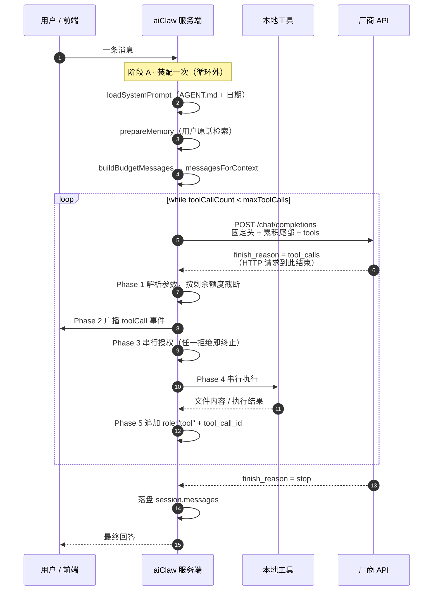

# 对话循环与上下文装配

> 本文说明「一条消息发出去之后到底发生了什麼」。对应代码：`server/src/chat/index.ts`。
> 写于 2026-11，实测参数来自租户 `ming` 的 `config.json`。

## 0. 一句话结论

**这不是黑盒，是 ReAct（2022）+ Function Calling（2023）的标准实现。**

- 循环跑在**本项目的服务端**，不在模型厂商那边
- 模型厂商（DeepSeek / 智谱 / 百炼 / Kimi）**不会主动回调**，它们是无状态 HTTP 接口
- 每一个工具轮次，都是一次**全新的、独立的 HTTP 请求**，需要**全量重发**上下文
- 同一次提问里，上下文分两段：**头部在循环内不动**（靠前缀缓存省钱）、**尾部追加**（工具结果）。下一次提问会重新装配，头部会变

---

## 1. 理论基础

### 1.1 Function Calling（2023，OpenAI）

训练模型输出**结构化 JSON** 表达「我想调用哪个函数、参数是什么」，而不是自然语言。模型**不执行**任何东西。

```jsonc
// 模型返回（finish_reason = "tool_calls"）
{ "tool_calls": [{ "id": "call_x", "function": { "name": "read", "arguments": "{\"path\":\"knowledge_base/index.md\"}" } }] }
```

### 1.2 ReAct（2022，Yao et al., [arxiv 2210.03629](https://arxiv.org/abs/2210.03629)）

**这是本项目循环结构的真正理论来源。** 核心是 Thought → Action → Observation 交错循环：

```text
Thought      我需要先看看知识库有哪些内容
Action       read("knowledge_base/index.md")
Observation  [真实文件内容]
Thought      有「示例」这个库，读它的索引
Action       read("knowledge_base/示例/index.md")
Observation  [内容]
Thought      够了，回答
```

**为什么必须交错**（论文的核心论点）：

| 方式 | 失败模式 |
|------|----------|
| 只推理（chain-of-thought） | 会幻觉出「事实」再一路推下去，**全程没有东西能纠正** |
| 只行动 | 盲目调工具，没有明确目标，难以调试 |
| **交错** | 每次 Observation 都是**用真实信息校准**的机会，错了能下一轮改 |

### 1.3 工程约束：bounded loop

ReAct 原文是 `while True`，实践必须设上限。DeepSeek 官方文档明确要求：

> Avoid an unrestricted `while True` loop. Use an application-defined maximum number of tool rounds.

本项目实现在 `server/src/chat/index.ts`（`runAgenticLoop` / `runAgenticLoopStreaming`）：

```ts
let toolCallCount = 0;
while (toolCallCount < maxToolCalls) {
  const allMessages = [...messages, ...extraMessages];
  const opts: CompletionOptions = { ...llmOptions, tools: llmTools };
  // ...
}
```

`maxToolCalls` 配置项：schema 默认 **10**（`config/schema.ts`），模板 `templates/config.json` 也已改为 **10**。现网租户的 `config.json` 需单独确认（数据目录在 NAS）。

---

## 2. 循环跑在哪一侧

行业只有两种架构：

| | 循环在**你的代码**里 | 循环在**厂商服务端** |
|---|---|---|
| 代表 | Chat Completions（OpenAI / DeepSeek / 智谱 / 百炼 / Kimi） | OpenAI Responses + hosted tools / 远程 MCP |
| 请求次数 | **N 次**（每工具一轮） | **1 次** |
| 工具执行者 | 你 | 厂商 |
| 能否用本地工具 | ✅ | ❌ 只能用厂商托管的 |
| 状态维护 | 你，每次全量重发 | 厂商 `store: true` |

**本项目用第一种，且在「本地私人知识库」定位下是唯一可行解**：工具是 `read`/`grep`/`write`，操作 NAS 上的私有文件。厂商服务器碰不到你的磁盘。

只有把文件通过 MCP 暴露到公网，才能用厂商的 server-side 循环——但那与「数据自己掌控」的目标相反。

### Cursor 是怎么做的

**结构完全一样**，都是客户端循环：

| | Cursor | 本项目 |
|---|---|---|
| 循环位置 | VSCode 扩展进程 | Node 服务端 |
| 工具 | 读写文件、终端、LSP、搜索 | `read`/`write`/`edit`/`grep`/`list`/`move`/`delete`/`remember`/`propose_change`/`distill` |
| 上下文装配 | 动态拼（打开的文件、光标、诊断、git） | 预算装配（宪法+记忆+历史），见 §3 |
| 轮数上限 | 类似 | `maxToolCalls` |
| 工具并发 | 未在本文核实 | **全串行**（见 §6.3） |

---

## 3. 完整时序



注意图中 `L-->>S` 每次都是一次**独立 HTTP 交换**：厂商不会主动发起任何请求，循环完全由服务端驱动。

### 阶段 A：装配一次（循环外，固定）

`chat/index.ts` 的流式入口（非流式入口在 823 行附近，结构相同）：

```ts
const systemPromptContent = await loadSystemPrompt(config);
const rootIndex = await loadRootIndexForInjection(config.injectRootIndex);
const memory = await prepareMemory(extractTextContent(llmUserMessage.content));
const distillMap = await loadDistillMapForInjection(config, memory.text);
const budget = buildBudgetMessages({
  config,
  run,
  systemPrompt: systemPromptContent,
  rootIndex,
  // ...
});
```

四步，**每步只做一次**：

| 步骤 | 做什么 | 是否随问题变化 |
|------|--------|----------------|
| `loadSystemPrompt` | 读 `agents/main/AGENT.md`，无则回退 `files/prompts/agent_system_prompt.txt`，末尾追加「今天的日期是…」 | 只跟**日期**变，不跟问题变 |
| `loadRootIndexForInjection` | 心得根索引（默认关） | 开关 |
| `loadDistillMapForInjection` | 蒸馏地图（默认关） | 开关 |
| `prepareMemory(用户原话)` | 用**这一句**去记忆库打分检索 | ✅ 跟问题变，但**只变一次** |
| `buildBudgetMessages` | 装配成 `messagesForContext` | — |

**关键：装配阶段不遍历目录。** 它只读几个已知路径的固定文件 + 记忆打分。真正的「去目录找」是模型在循环里自己决定的。

### 阶段 B：Agent 循环（最多 maxToolCalls 轮）

```ts
let toolCallCount = 0;
while (toolCallCount < maxToolCalls) {
  const allMessages = [...messages, ...extraMessages];  // 固定头 + 累积尾部
  // ... provider.stream / provider.complete
}
```

- `messages`：阶段 A 装配好的那一份，**循环内从不修改**
- `extraMessages`：只追加 `assistant(tool_calls)` 和 `tool(result)`

每轮的变化：

```text
第1轮  [固定头] + 你的问题                                    → 模型要 read
第2轮  [固定头] + 你的问题 + tool_calls + read结果            → 模型要 grep
第3轮  [固定头] + 你的问题 + ... + grep结果                   → 模型要再 read
第4轮  [固定头] + 你的问题 + ... + read结果                   → finish_reason=stop，输出
```

**同一次提问里，变的是尾部，头部不动。** 这是为了命中 provider 的前缀缓存（缓存价约为正常价的 1/10）。下一次提问会重新跑阶段 A：`prepareMemory` 按新问题检索，记忆块因此变化，前缀缓存对「下一条用户消息」不保证命中。

### 阶段 C：一次工具调用的内部五步

`runAgenticLoop` 用 Phase 1~5 注释标出：

1. **Phase 1**：解析 `tool_calls` 的 JSON 参数，按 `maxToolCalls - 已用` 截断
2. **Phase 2**：先向前端广播全部 `toolCall` 事件（UI 能提前显示）
3. **Phase 3**：**串行**逐个 `checkPermission`（前端一次只能显示一个弹窗）；任一个被拒 → 立即终止整轮
4. **Phase 4**：**串行**执行工具（原因见 §6.3）
5. **Phase 5**：把结果作为 `role: "tool"` 消息追加，带上 `tool_call_id`

每轮 Phase 5 结束后会推送一个 `loopProgress` 事件（`round`、`toolCalls`、`maxToolCalls`），前端据此显示「第 N 轮 · 已调用 M/上限」。这是循环唯一的实时进度来源：轮数无法预知（取决于上轮读到什么），但已发生多少轮始终可见。

---

## 4. 对话历史 vs 本次循环：两套不同的「上下文」

容易混淆，必须分开：

| | 会话历史 | 本次循环的 `extraMessages` |
|---|---|---|
| 来源 | 之前各轮已落盘的消息（`session.messages`） | 本次提问产生的工具往返 |
| 循环进行中 | 只读，作为阶段 A 的 `history` | 只在内存里追加 |
| 循环结束后 | 不变 | **写入** `session.messages`，成为下一轮的历史 |
| 装配时处理 | `groupByTurn` 分组，按预算从新到旧装填 | 当轮无预算，直接追加 |
| 超限行为 | 整组丢 turn，不提示 | 当轮无二次检查（见 §6.2） |

工具结果不是厂商缓存。缓存只影响费用，不减少窗口里的内容。一次 `read` 的原文会留在会话里，下次提问整段重发，直到该 turn 因预算装不下被整组丢掉。在 `contextMaxTokens = 500000` 时，这个丢掉很少发生，所以大结果会长期占着历史。

上面是**当前代码**。目标规则在 `context_governance_plan.md`：心得会话在游标之后的原文都进入窗口；超过约 8000 token 的待处理部分才收进「当前有效」。收成功后那一批退出窗口。工具结果等该轮被游标盖住后再按字节缩短。不要在 Phase 5 里截断。

---

## 5. Token 累积：为什么多轮工具很贵

假设固定头 2574 token（宪法 383 + 工具定义 2191），每次工具结果约 1000 token：

| 轮次 | 单次输入 | 说明 |
|------|----------|------|
| 1 | ~3000 | 固定头 + 问题 |
| 2 | ~4000 | + 第 1 个工具结果 |
| 3 | ~5000 | + 第 2 个 |
| 4 | ~6000 | + 第 3 个，输出答案 |

**总输入 ≈ 1.8 万**，而真正的新内容只有 3000。输入 token 是**累积重发**的，4 轮接近二次增长。

`maxToolCalls: 30` 的最坏情况：若每轮工具结果 1000 token，单轮输入可达 3 万，30 轮总输入接近 **50 万 token**。

因此模板已从 30 下调为 **10**：10 轮的总输入约 5.5 万 token，且对「个人知识库查询」通常足够。

这就是为什么：
- 前缀缓存很重要（重复部分打 1 折）
- `maxToolCalls` 不宜过大
- 工具应尽量「一次拿够」，而不是零碎多次读

---

## 6. 已知弱点与可优化点

### 6.1 记忆只检索一次

`prepareMemory` 用**用户原始文本**作为 query，且只在阶段 A 执行一次。

- 若用户问「这个怎么弄？」，几乎检索不到有效记忆
- 即使模型在第 5 轮读到了相关文件，记忆也**不会重新检索**

这是缓存优先架构的固有 trade-off：想二次检索就得重排头部，缓存失效。

### 6.2 工具追加内容没有超窗保护 ⚠️

`assembleContextBudget` 只在**循环开始前**做预算，`assertAssembled` 也只断言初始装配。

循环内 `extraMessages` 无限追加，**没有任何二次检查**。若模型连续读多个大文件，可能直接超窗，provider 报错。

单个 `read` 已有限制（`DEFAULT_READ_LINES = 2000`、`MAX_READ_BYTES = 50 KiB`），但**多个 50KB 累加**没有上限保护。

### 6.3 工具全串行

`chat/index.ts` Phase 4 用 `for` + `await` 串行执行。注释说明原因：

> Edit 等写文件操作是「读→改→写回」，并行执行（尤其同一文件多个 Edit）会互相覆盖导致修改丢失

**结论正确，但对只读工具过于保守**。`read`/`grep`/`list` 无副作用，并行化能显著降低延迟。

### 6.4 系统提示词带日期，跨天破坏缓存

同一天内前缀稳定（缓存有效），**跨天则整个 system message 变化**，前缀缓存失效。影响为每天首次对话，量级不大但值得知道。

```ts
// server/src/chat/index.ts · loadSystemPrompt
const dateLine = `今天的日期是${formatToday()}`;
return content ? `${content}\n\n${dateLine}` : dateLine;
```

### 6.5 `maxToolCalls` 已调整为 10

原值 30 偏大：对「个人知识库查询」场景，10 通常足够，触顶说明没找到、应换问法而非继续翻。若实测频繁触顶，再逐步放宽到 15。

调整后循环轮次上限从 30 降到 10，最坏情况总输入从约 50 万 token 降到约 5.5 万。

---

## 7. 与其他方案的对比

| 方案 | 可行性 | 评价 |
|------|--------|------|
| **客户端 ReAct 循环**（当前） | ✅ | 正确选择 |
| OpenAI Responses + hosted MCP | ❌ | 要求文件经 MCP 暴露公网，与「本地私有」冲突 |
| 一次性 RAG（检索完直接答） | 🟡 | 更快更便宜，但模型无法按需深入，对探索式查询明显更弱 |
| 只读工具并行 | 🟡 | 读类可并行，写类必须串行。当前全串行，有优化空间 |

---

## 8. 是否主流 / 能否自定义

### 8.1 是否主流

是。主流分三类，第一类就是本项目形态：

| 形态 | 代表 | 与本项目差异 |
|------|------|--------------|
| **自写循环 + 工具表 + provider 适配**（当前） | 多数自建产品 | — |
| 框架封装同一循环 | OpenAI Agents SDK、Vercel AI SDK、LangChain `AgentExecutor`、Pydantic AI | 内部仍是 `while + tool_calls`，只多状态/重试/trace |
| 厂商托管循环 | OpenAI Responses + hosted tools / 远程 MCP | 不可用：工具需访问本地磁盘 |

框架不产生新机制。`AgentExecutor`、`Runner.run` 展开后仍是「POST → 判 `tool_calls` → 本地执行 → 追加 → 再 POST」。引入框架只增加依赖和隐式状态，本项目的 200 行实现已覆盖同等能力。

工具数量会影响选择准确率（目录 51→584 个时路由 F1 降 16–23pp，[arXiv 2606.17519](https://arxiv.org/html/2606.17519)），但本项目仅 **15 个**，远在安全区间。

### 8.2 自定义的三个层次

只有前三档是「改配置/改文字」，机制层不建议动：

| 层 | 入口 | 建议 |
|----|------|------|
| **机制层**（循环怎么转） | `chat/index.ts` 的 `while` | ❌ 不改。改它收益极低、风险极高 |
| **配置层**（跑多长、带什么工具） | `maxToolCalls`、`tools.*`、`compaction.*`、`fs.policy` | ✅ 该调的地方 |
| **提示词层**（行为与流程） | `agents/main/AGENT.md` 优先，`files/prompts/agent_system_prompt.txt` 回退 | ✅ **成本最低、最有效的杠杆** |

项目的流程规范本来就用提示词表达，例如：

> 目录里若有 `_index.md`…看结构时先读 `reflections/_index.md`，再逐层下钻，**一次只读一层**。

这是一条可执行的流程约束，写进提示词即生效，无需改代码。

### 8.3 Skill 能否实现：能，且无需新机制

Agent Skills 的三层结构（[Anthropic 官方](https://platform.claude.com/docs/en/agents-and-tools/agent-skills/overview)）：

| 层 | 内容 | 加载时机 | 成本 |
|----|------|----------|------|
| L1 元数据 | `name` + `description` | 启动时**总是**注入系统提示词 | ~100 token/个 |
| L2 正文 | `SKILL.md` | 匹配后由模型**自己用工具读** | <5k |
| L3 资源 | `REFERENCE.md`、`scripts/` | 用时才读/执行 | 到用时才算 |

注：上表描述的是 Anthropic Skills 的原生能力。本项目只有「读」这一半，没有脚本执行能力，详见下文。

**L2 读取不需要新代码**：Skills 触发时 Claude 调用 `Bash` 读取 `SKILL.md`，本项目可用现有 `read` 工具完成，前提是 skill 目录在 `fs.policy` 的可读范围内。

**L3 脚本执行本项目不具备**：`server/src/tools/` 下没有任何 `child_process`/`exec`/`spawn` 调用，无命令执行工具。若 skill 需要运行 `scripts/`，必须新增一个受 `fs.policy` 与风险分级约束的执行工具，这是独立的安全决策，不是配置问题。

因此 Skill 在本项目的可行范围是「**只读的流程知识**」：L1 元数据注入 + L2 由 `read` 加载，L3 仅限 markdown 参考资料。

缺的只有 **L1 自动注入**：装配时扫 `skills/*/SKILL.md` 的 frontmatter，把 `name + description` 拼进系统提示词，模型自行决定是否 `read` 全文。实现量取决于 frontmatter 解析方式（手写 YAML 子集解析，或引入 `yaml` 依赖），未评估前不给具体行数。

这与现有 `_index.md` 是同一思路——先给目录，再按需下钻。区别是 `_index.md` 由脚本维护、面向数据；skill 面向「做事的方法」。

**代价**：L1 元数据位于系统提示词，即**固定头**。改动 skill 描述会改变所有请求的前缀，**缓存失效**（同 §6.4 日期问题）。因此 skill 宜少（≤10 个）、描述稳定后勿频繁修改。

### 8.4 结论：现在不做 skill

| 需求 | 手段 | 何时采用 |
|------|------|----------|
| 调整风格、目录规范 | 改 `AGENT.md` | 现在即可 |
| 固定多步流程 | 写进 `AGENT.md` 一节 | 现在即可，通常够用 |
| 流程知识膨胀 | `skills/` + L1 注入 | **`AGENT.md` 超过 1500 token 后** |
| 按场景裁剪工具 | 工具门控（按 config 条件注册） | **工具增至 30+ 后** |
| 换框架 | — | ❌ 不值得 |

理由：现有 `AGENT.md` 仅 42 行 / 383 token，工具 15 个，单租户自用场景流程固定；Skill 的主要收益是「对不特定用户分发大量能力」，与本项目定位不符。且 L1 注入会动固定头，直接影响刚优化过的缓存成本。

已定的上下文规则见 `context_governance_plan.md`：记忆分层配额，以及历史里的大工具结果变短。当轮循环内仍用全文，不在 Phase 5 截断。

---

## 9. 关键常量速查

| 项 | 值 | 位置 |
|----|-----|------|
| `maxToolCalls` 默认 | 10（schema） | `config/schema.ts` |
| `maxToolCalls` 模板默认 | 10 | `templates/config.json` |
| `POLICY_TOKEN_MAX` | 6000 | `chat/index.ts` |
| `MEMORY_TOKEN_MAX` | 7500（四层硬顶之和） | `memory/types.ts` |
| `LAYER_TOKEN_MAX` | user 2000 / focus 1500 / runtime 1500 / longterm 2500 | `memory/types.ts` |
| `LAYER_INJECT_MAX` | user 4 / focus 3 / runtime 3 / longterm 5 | `memory/types.ts` |
| `ROOT_INDEX_TOKEN_MAX` | 1000 | `chat/index.ts` |
| `ROOT_INDEX_BYTE_MAX` | 1024 | `chat/index.ts` |
| `DISTILL_MAP_TOKEN_MAX` | 1200 | `chat/index.ts` |
| `DIALOGUE_STATE_TOKEN_MAX` | 2000 | `chat/dialogue-state.ts` |
| `FOLD_TRIGGER_TOKENS` | 8000（只触发，不限制窗口） | `chat/dialogue-fold.ts` |
| `FOLD_KEEP_ROUNDS` | 2 | `chat/dialogue-fold.ts` |
| `TOOL_STUB_BYTES` | 4 KiB | `chat/dialogue-fold.ts` |
| `IMAGE_TOKEN_ESTIMATE` | 800 | `chat/context-budget.ts` |
| `DEFAULT_READ_LINES` | 2000 | `tools/file-tools.ts` |
| `MAX_READ_BYTES` | 50 KiB | `tools/file-tools.ts` |
| `BATCH_THRESHOLD` | 3 | `tools/risk.ts` |
